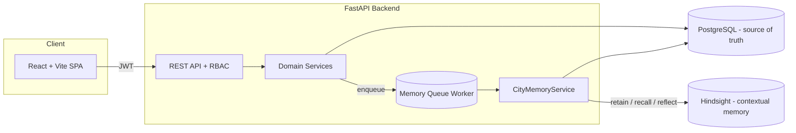
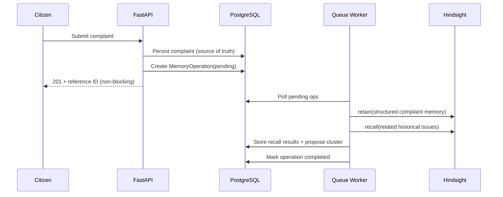

# CityFix

**Cities that remember. Problems that stay solved.**

CityFix is an AI-powered civic intelligence platform. Citizens report local problems; municipal officers investigate and resolve them. Unlike ordinary ticketing systems that treat every complaint as an isolated record, CityFix **remembers** the history of an issue — past complaints, attempted repairs, and their real outcomes — using the [Hindsight](https://hindsight.vectorize.io/) agent-memory system, and connects new complaints to related historical incidents.

---

## Problem statement

Traditional complaint systems create a fresh ticket for every report. When a pothole is "fixed" and returns after rain, or a drain is cleaned and floods again a month later, the system has no memory of the prior intervention. Officers rediscover the same problems from scratch. Recurring issues hide behind different wording, different citizens, and closed tickets.

## Why CityFix is different

CityFix layers **persistent, contextual memory** over a conventional PostgreSQL system of record:

- Every complaint, action, and outcome is written to Hindsight as a structured memory.
- New complaints **recall** semantically and contextually related past incidents — even when worded differently.
- A multi-signal detector (semantic similarity + geographic distance + category + time + prior outcomes) proposes recurring-issue clusters, which officers confirm or reject.
- AI action briefs are **grounded** in retrieved memories and cite the exact complaint IDs and dates behind every claim.
- The system never asserts an issue is permanently resolved without supporting evidence.

PostgreSQL remains the source of truth for official records. Hindsight provides the memory and recall that a plain SQL `LIKE` query cannot: cross-wording semantic recall, entity/temporal reasoning, and reflective synthesis over accumulated experience.

## Features

- Role-based app for **Citizens**, **Municipal Officers**, and **Admins** (backend-enforced RBAC).
- Complaint submission with map location (Leaflet + OpenStreetMap), photos, categories, severity.
- Officer investigation page with civic-memory timeline and grounded AI brief.
- Recurring-issue clusters with confirm/reject, merge, and split.
- Failed-fix intelligence (repair → recurrence detection with cautious language).
- Civic memory map with clustering and filters.
- Admin panel with memory-operation monitoring and retry.
- Database-backed async memory queue with idempotency + bounded retry.
- Seeded demo scenario and guided "Explore Demo" experience.

## Technology stack

| Layer | Tech |
|---|---|
| Frontend | React, TypeScript, Vite, Tailwind, shadcn-style UI, Lucide, React Router, TanStack Query, React Hook Form, Zod, Leaflet |
| Backend | Python, FastAPI, Pydantic v2, SQLAlchemy 2, Alembic |
| Database | PostgreSQL (Supabase-compatible) |
| Memory/AI | Hindsight (`hindsight-client`), LLM via Hindsight `reflect` |
| Deploy | Vercel (frontend), any Python host (backend), Supabase (DB) |

## Architecture



### Memory data flow



## Database schema overview

`User`, `Department`, `OfficerDepartmentAssignment`, `Complaint`, `ComplaintAttachment`, `ComplaintStatusHistory`, `IssueCluster`, `IssueClusterMembership`, `OfficerAction`, `ActionEvidence`, `ComplaintComment`, `CitizenFeedback`, `Notification`, `MemoryOperation`, `AuditLog`. UUID primary keys, timestamped, foreign-keyed, indexed on status/category/department/created/cluster/memory-status.

## How Hindsight is used

The `CityMemoryService` (`backend/app/memory/service.py`) wraps the official `hindsight-client`:

| Service method | Hindsight call |
|---|---|
| `remember_complaint()` | `retain()` structured complaint memory |
| `recall_related_issues()` | `recall()` by description + location + category |
| `remember_officer_action()` | `retain()` action + outcome context |
| `remember_resolution_outcome()` | `retain()` confirmed/assumed outcome |
| `generate_issue_brief()` | `reflect()` grounded synthesis with `based_on` sources |
| `get_memory_status()` | health probe of client + queue metrics |
| `retry_failed_memory_operations()` | re-enqueue failed `MemoryOperation` rows |

A stable **memory bank** (`CITYFIX_MEMORY_BANK`) isolates the app's namespace. If Hindsight is not configured, the service runs in a clearly-labelled **degraded** mode: complaints still persist, operations are marked `skipped`, and the UI shows the memory feature as unavailable rather than faking success.

## Local setup

### Prerequisites
- Python 3.11+ (tested on 3.14)
- Node 18+
- PostgreSQL 14+ for production/Supabase. For a **zero-config local run**, the default
  `DATABASE_URL` uses SQLite (`sqlite:///./cityfix_dev.db`) so you can try everything
  without a database server. Switch `DATABASE_URL` to your Postgres/Supabase connection
  string for production.

### 1. Backend

```bash
cd backend
python -m venv .venv
# Windows: .venv\Scripts\Activate.ps1   |  Unix: source .venv/bin/activate
pip install -r requirements.txt
cp .env.example .env   # then edit values (defaults work out of the box with SQLite)
alembic upgrade head
python -m scripts.seed_demo         # loads demo scenario + users
uvicorn app.main:app --reload
```

> The initial Alembic migration lives at `backend/alembic/versions/`. For Postgres,
> set `DATABASE_URL` before running `alembic upgrade head`.

Backend runs on http://localhost:8000 — docs at `/docs`.

The memory queue worker runs in-process by default (`RUN_INLINE_WORKER=true`). To run it standalone:

```bash
python -m app.workers.memory_worker
```

### 2. Frontend

```bash
cd frontend
npm install
cp .env.example .env   # set VITE_API_URL
npm run dev
```

Frontend runs on http://localhost:5173.

## Environment configuration

See `.env.example` in the repo root, `backend/`, and `frontend/`. Required backend variables: `DATABASE_URL`, `JWT_SECRET`, `ADMIN_SEED_EMAIL`, `ADMIN_SEED_PASSWORD`, `HINDSIGHT_BASE_URL`, `HINDSIGHT_API_KEY`, `HINDSIGHT_MEMORY_BANK`, `CORS_ORIGINS`.

## Demo data & reset

```bash
cd backend
python -m scripts.seed_demo    # seed
python -m scripts.reset_demo   # wipe demo rows and re-seed
```

### Demo login credentials (seeded)
- Citizen: `citizen@demo.cityfix.app` / `Demo1234!`
- Officer: `officer@demo.cityfix.app` / `Demo1234!`
- Admin:   set via `ADMIN_SEED_EMAIL` / `ADMIN_SEED_PASSWORD`

## Running tests

```bash
cd backend
pytest        # Hindsight + LLM are mocked in unit tests
```

Set `HINDSIGHT_API_KEY` and run `pytest -m integration` for the live Hindsight connection test.

## Deployment

- **Frontend**: Vercel, build `npm run build`, output `dist`, set `VITE_API_URL`.
- **Backend**: any Python host (Render/Railway/Fly). Run `alembic upgrade head`, then `uvicorn app.main:app`.
- **Database**: Supabase PostgreSQL — use the pooled connection string as `DATABASE_URL`.

## Demo walkthrough

Open `/demo` in the app for the guided scenario: historical pothole → temporary repair → resolved → new complaint (different wording, same place) → Hindsight recall → grounded recurrence brief → permanent repair → outcome recorded → subsequent complaint influenced by accumulated history.

## Limitations

- Hindsight `reflect` confidence is presented qualitatively, not as a calibrated probability.
- Recurring-issue thresholds are heuristic and configurable; officers must confirm matches.
- File storage defaults to local disk; swap in S3/Supabase Storage for production.

## Future improvements

- Notification push/email transport, WebSocket live updates, mobile PWA, richer analytics, per-department Hindsight banks for stronger tenant isolation.
